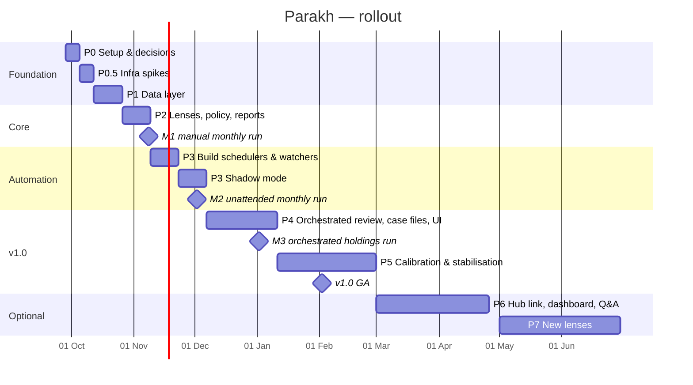

# Phased Rollout Plan

## 1. Rollout strategy at a glance

Three things expand gradually, each behind a config flag:

| Dimension | Step 1 | Step 2 | Step 3 |
|---|---|---|---|
| **Coverage** *(D26)* | Pilot: 7 stocks (plan 13 D3, §8.0c) | All holdings from the CAS (about 11), each onboarded with a thesis | Same set; holdings added or sold through the CAS import |
| **Benchmark panel** *(D26)* | Prices only, the AMFI Large, Mid and Small lists (about 498 stocks, D30), no fundamentals or scores | + NSE index P/E, P/B, yield and TRI as index benchmarks (plan 17) | Optional curated peers after M1 |
| **Automation** | Manual CLI runs | Scheduled, **shadow mode** (alerts to a log only) | Live alerts |
| **Intelligence** *(D27)* | Deterministic lenses; read-only MCP tools for you in Claude | + Orchestrator in `dry_run` shadow beside the linear fallback; Monthly Reviewer and Event Triage agents | + Orchestrated review (planner, specialists, synthesis), Portfolio Analyst, Devil's advocate on holdings; momentum calibration |

**Feature flags** (`config/*.yaml`): `lenses.enabled`, `coverage.mode: pilot|holdings`, `panel.enabled`, `agents.orchestrator.enabled`, `agents.orchestrator.fallback: linear`, `integration.provider` / `integration.publisher`, `alerts.dry_run`, `watchlist.enabled` *(parked, default off)*, `qualitative.enabled`, `llm.budget_tokens`, `ui.enabled`, *(v1.9)* `mcp.toolsets.enabled` (per toolset), `agents.<id>.enabled`, `agents.dry_run` (agent output to `logs/agents_shadow.md` only). Every risky capability can be switched off without a code change.

**Milestones anchored to real month-ends:**

| Milestone | Target date | Proves |
|---|---|---|
| **M1: First manual monthly run** (pilot, Oct month-end data) | 2026-11-08 | Data → lenses → verdict → report works end to end |
| **M2: First unattended monthly run** (Nov month-end) | 2026-12-02 | Scheduling, notifications, idempotency |
| **M3: First orchestrated holdings run with Streamlit** (Dec month-end) | 2027-01-02 | Orchestrated review, case files, holdings, approvals |
| **v1.0 GA:** 3 consecutive unattended runs | 2027-02-02 | PRD §13 release criteria |

## 1b. Rework from the narrowing (D26–D28)

Detail and hour estimates: plan 13 §8.0f; coverage model in plan 17; contracts in plan 18; orchestrator in plan 15 §5b.

| Item | What | Phase |
|---|---|---|
| R1 | Docs brought in line with D26–D28 | 0 |
| R2 | Coverage set versus benchmark panel split in config and code | 1 |
| R3 | NSE index benchmark pack (spike, loader, mapping to lens inputs) | 0.5 spike; 3 loader and mapping (after M1) |
| R4 | Onboard each holding with a thesis and golden fixtures | 3 (after the M1 review) |
| R5 | Panel stages (prices only) in the scheduled flow | 3 |
| R6 | Orchestrator, dispatcher and case-file assembler | 3 shadow, 4 live |
| R7 | Portfolio Analyst and the Drishti-derived items | 4 |
| R8 | `holdings.v1` and `insights.v1` contracts, providers and publishers | 3 (after M1) |
| R9 | WealthLens Hub link (views, scoped roles) | 6, after GA |
| R10 | Calibration framing: momentum only, value reported as unproven | 5 |

**Agentic build method (every agent, including the orchestrator):** eval first. Write the agent card and its output schema, then a `FakeRunner` trajectory test, then the prompt, then the L7 gate (plan 14). An `AGENTS.md` in the repo records these rules for the coding pair. No agent is enabled before its trajectory test passes; the orchestrator also runs in `dry_run` shadow beside the linear path for at least one monthly run before it is live.

M1 and M2 do not depend on the orchestrator. Only R1, R2 and the R3 spike sit before M1; M1 stays on the 7 pilot stocks and R3 loader and mapping, R4 and R8 start in Phase 3, after the review.

---

## 2. Phases

Every exit gate below also includes that phase's **test gate in plan 14 §9**. Milestones are accepted through the **UAT sessions in plan 14 §7**.

### Phase 0: Setup and decisions (2026-09-28 → 10-04)

| | |
|---|---|
| **Goal** | Skeleton that enforces the standards from day one |
| **Features** | F18 (base classes, registries), F19 (logging skeleton), **F21 (audit core)**, F22 (tokens and formatters), **F24 (skeleton)** |
| **Tasks** | Decisions already locked (plan 13) · run aiscaffold (**Production**) *(done 28 Sep)* · repo `Stock Analysis\parakh` in OneDrive, venv outside OneDrive (D10, amended 28 Sep) · Supabase `parakh` project + migrations + RLS skeleton (D11) · module layout with `agents/`, `mcp/` and `orchestration/` (P2, reworded in 13 v1.13) · gitleaks + pip-audit required checks (P10) · `pyproject` + `uv.lock`, ruff, pyright, pre-commit · CLAUDE.md / AGENTS.md · `Lens` / `LensResult`, metric/signal/lens registries · config schemas (Pydantic) · load the 7 pilot symbols, keyed by ISIN (D3) · copy FRAMEWORK docs to `docs/` · ADR files 001–012 · **Agentic (plan 15):** scaffold with the Claude Agent SDK instead of LangGraph (`stack_config.yaml`), `src/mcp/` server skeleton with tool registry (ID + tier required) and audit middleware, `AgentRunner` + `FakeRunner`, `config/agents.yaml` schema, `parakh_mcp` DB role, `.mcp.json`, `docs/TOOLS.md` generator · **Governance:** `RunContext` + ULID run_id, structlog + redaction, `audited_step`, JSONL audit sink, `AUD.*` enums, PR template, branch protection on `main` · **UI/UX (plan 12):** `config/ui_tokens.yaml`, `src/render/format.py` (₹ en-IN, L/Cr, %, dates), token lint · **doc lint** (milestone dates and phase-placement tables only in 09, test gates excepted; README and 08 Part A checked against 09; plan 14 L0) |
| **D26–D28 rework (R1, R3 spike)** | Docs aligned to D26–D28 (R1) · NSE benchmark download spike (1 h, from the cloud runner; R3a) |
| **Exit gate** | `run.py --help` works · pre-commit and CI green · test harness live (plan 14 §9, Phase 0) · config validates · decisions recorded · a dummy run emits START/END audit events and a manifest · redaction test green |
| **Risk** | Decision paralysis → default to the recommended options, which can be revised later |

### Phase 0.5: Infrastructure spikes (10-05 → 10-11)

| | |
|---|---|
| **Goal** | Retire the biggest unknowns before building on them (plan 04 §4) |
| **Tasks** | ① NSE/BSE access from a GitHub-hosted runner (bhavcopy, announcements); fallbacks if blocked · ② port Drishti's transcript pipeline with the new Screener Concalls → BSE-filed PDF provider (D7) · ③ Screener export format + XBRL parse of one company · ④ corporate-action handling on a known split/bonus stock · ⑤ `SupabaseRepository` + Parquet in Supabase Storage queried by DuckDB (D11) · ⑦ parse your latest CAS with casparser; confirm fields and PII handling (D8, P6) · ⑥ Telegram bot hello-world · ⑧ *(v1.9)* Claude Agent SDK on a GitHub-hosted runner: install, spawn `parakh-mcp` over stdio, one allow-listed tool call with built-in tools disabled; and the same server connected from Claude Desktop on your PC (ADR-011, ADR-012) |
| **D26–D28 rework (R3 spike)** | Record the NSE Indices P/E, P/B, yield and TRI download outcome as an ADR-013 note |
| **Exit gate** | Each spike has a written outcome (ADR update or note); no unresolved blocker |
| **Rollback** | If NSE is blocked from the cloud, add a self-hosted runner on the PC for NSE steps (ADR-003 amended). If the Agent SDK can't run on the hosted runner, add a plain-API `AgentRunner` adapter or run agent steps on the self-hosted runner (ADR-011 revisit) |

### Phase 1: Data layer (10-12 → 10-25)

| | |
|---|---|
| **Goal** | Trustworthy, validated inputs for the pilot |
| **Features** | F02, F01, F03 (holdings import + lots, CLI only) |
| **Tasks** | Price adapters (yfinance → bhavcopy fallback) · fundamentals adapters (Screener export, XBRL cross-check) · shareholding/pledge · index constituents + AMFI list · ISIN master, symbol map, corporate actions · pandera schemas, cross-source reconciliation, `data_quality` block · *(v1.10, D24)* profile inputs for the pilot: lease liabilities and EBITDAR (INDIGO), listed-stake register with stake % from shareholding filings (M&M), customer advances from filings (MAZDOCK), listing dates for the young listings *(v1.12: the MAZDOCK order book and the offer-document financials are PDFs and move to the Phase 2 document work, plan 13 §8.0c)* · caching and throttling · holdings: CAS import + one-time cost-basis seed + lot model; CAS PII rules and redaction test (D8, P6) · **Governance:** source registry, lineage fields (source, tier, as-of, raw hash), DQ scorecard, `AUD.DATA.*` events, raw-input archive, Supabase append-only audit tables (trigger + RLS) + outbox flush, encrypted weekly backups (D11, P9) |
| **D26–D28 rework (R2)** | Split coverage (holdings) from the benchmark panel; the panel loads prices only |
| **Exit gate** | 10 years of prices + fundamentals for each pilot stock (since listing for GROWW, ATHERENERG, SHADOWFAX), with source stamps · AC-F02.1–5 pass · CAS import reconciles with the statement for every ISIN (AC-F03.1, F03.7) · golden inputs frozen and **UAT-0 signed** (oracle, plan 14 §4.1) |

### Phase 2: Lenses, policy and reports (10-26 → 11-08) → **M1**

| | |
|---|---|
| **Goal** | End-to-end analysis for the pilot, reviewed by you |
| **Features** | F04 (incl. pilot profiles and history classes, AC-F04.7–12), F05 (incl. limited history, AC-F05.7–9), F08, F09, F10 (basic), F16 (regime basics), F23 (thesis file, metric exit checks, report Thesis check), F24 (read toolsets) |
| **Tasks** | Value metrics + sector profiles + archetypes + reverse DCF + vetoes · *(v1.12)* document inputs for the pilot profiles: MAZDOCK order book from investor presentations, offer-document financials for GROWW, ATHERENERG and SHADOWFAX · *(v1.10, D24)* profiles for airline/lease-heavy, conglomerate SOTP, order-book, capital-market intermediary and new-age (plan 01 §3), history classes H0–H2 and the value-informational rule in the verdict policy, momentum minimum-history rules (plan 02 §3.9) · momentum indicators + signals M01–M30 + Trend Template + stages + regime · verdict policy YAML + hysteresis + attribution · JSON snapshot → MD report (plan 00 §8 template), history.csv, HISTORY.md · segment summary (basic) · golden tests on the D18 stocks (plan 14 §4.1) · **Governance:** verdict explanations + `explain` CLI, model inventory + cards (value, momentum), overrides with expiry, run manifest v1 · **UI/UX:** report top block (TL;DR, verdict chip prev → now, what changed, action box), `
` sections, tri-state checks, chart context (entry cost, fair-value band, next event), `run.py share` export + redaction test, `[[SYMBOL]]` links in segment summaries · **Agentic (plan 15):** read-only toolsets `reports.*`, `analytics.explain_verdict`, `analytics.list_catalogue`, `audit.get_run`; `parakh://` resources; `/monthly-review` and `/explain` prompts; MCP-vs-CLI equivalence test on the golden stocks (AG-04). Only R-tier tools before M1 |
| **M1 (2026-11-08)** | Manual run on **October month-end (as-of 2026-10-30)** for the pilot; you review all 7 reports (in the files, and optionally by asking Claude Desktop through `parakh-mcp`). Then the **backlog review** (D25): decide F26 and any ideas logged since 28 Sep |
| **D26–D28 rework** | None before M1. M1 stays on the 7 pilot stocks; R3 mapping, R4 and R8 start in Phase 3 |
| **Exit gate** | **UAT-1 passes**: ≥ 6 of 7 reports pass the plan 14 §7.3 rubric, 0 S1 (disagreements become tickets) · AC-F04, F05, F08, F09 pass |
| **Status (2026-10-02)** | **Lenses, policy and reports built; L1–L3 tests green; UAT-1 awaits your review.** Value and momentum lenses, verdict policy, snapshot-first reports, history, segment summary, regime basics, thesis checks, read-only MCP tools (`reports`, `analytics`), explain CLI, model cards, overrides and run manifest v1 are in. A dry run on 2026-09-30 data produced all 7 reports. Sector-profile inputs come from the Phase 1 filing loader (lease liabilities and customer advances feed the lens; listed-stake percentages are read, but investee market caps are not loaded, so SOTP stays N/A). Golden tests (HDFCBANK, INDIGO, M&M) are **regression baselines** on parsed Screener facts with synthetic prices; the UAT-0 oracle is still absent. **Update 2026-10-11 (PR #35):** the INDIGO lease double count is fixed (Screener borrowings already contain the leases) and lease cost is the TTM of four filed quarters; `config/document_inputs.yaml` carries the MAZDOCK order book and the HDFCBANK ratios with source, tier and date, unused until you set `verified: true`. The GROWW, ATHERENERG and SHADOWFAX offer-document financials are a validation task, not a data gap. **Still open before M1:** M&M investee market caps (30 Oct freeze), M&M unlisted book and standalone net debt, the HDFC NIM basis; confirm tax rates and portfolio limits; review the HDFCBANK promoter 0% and merger-dilution artefacts and the GROWW and ATHERENERG negative-CFO vetoes. Peers, events and the qualitative layer are N/A until Phases 3–4; segment XIRR, drawdown and correlation move to Phase 4. |
| **Note** | November has Diwali holidays and a special Muhurat session, a live test of the holiday calendar |

### Phase 3: Automation, then shadow mode (11-09 → 12-06) → **M2**

| | |
|---|---|
| **Goal** | Hands-off operation with notifications, proven quietly before going live |
| **Status (2026-10-04)** | **Automation, watchers, notifications and the two agents are built; shadow mode starts when the workflows are switched on.** Seven GitHub workflows (monthly, daily watch, daily events, evening digest, Sunday heartbeat, bot poll, daily integrity); Telegram, email with a 30-day `.ics`, optional ntfy and an owner-only bot (`/today /stock /pending /status /mute /privacy`, signed buttons); the momentum watcher (first scan seeds silently, 2-close confirmation, cool-downs, re-arm) with shadow and 60-day replay modes; the event watcher on real NSE feeds (filings, insider and pledge, ASM/GSM, deals, lock-ins) with once-only filing keys and a per-stock history; market context (FII/DII 20-session flow, breadth) feeding the regime; thesis status-change alerts and a Home inbox; `notify.queue` and `data.get_document` MCP tools; Monthly Reviewer and Event Triage agents with cards and a model-inventory row; `alerts_log` migration; `docs/FAILURE_MODES.md` (19 rows); run manifests now carry alert, agent and token counts; heartbeat flags NFR-14 breaches. `alerts.dry_run` and `agents.dry_run` are both `true`. **Not done here:** F24.4 (`portfolio.positions` arrives with the Phase 4 portfolio toolset); `jobs.request_refresh` (Phase 4, so the rules queue refreshes, capped at 5 a day); workflow secrets from AWS SSM (BL-01); applying the migration to Supabase; the shadow weeks themselves. **Your actions:** add the workflow secrets, apply the migration, switch the workflows on, then review `logs/alerts_shadow.md` and `logs/agents_shadow.md` twice a week. |
| **Features** | F11, F12, F13, F19 (alerts, heartbeat), F16 (VIX, flows, breadth), F23 (status-change alerts), F24 (`notify.queue`), F25 (Monthly Reviewer, Event Triage) |
| **Tasks, weeks 1–2 (build)** | GitHub Actions workflows (monthly, daily watch, daily events) · Telegram notifier + message templates · state store, confirmation, de-duplication, cool-down, severity + ownership routing · event parsers (announcements, insider trades, pledges, surveillance, ratings) · failure alerts + Sunday heartbeat · holiday calendar · **Governance:** `alerts_log` incl. suppressed alerts, hash chain + daily integrity check + git anchors, audit completeness test, governance line in Telegram, CI impact preview on config PRs · **Production:** workflow secrets from AWS SSM via OIDC (P1, ADR-009), `docs/FAILURE_MODES.md` and SLO monitoring before M2 (P7, P8) · **Notifications (ADR-008):** `Notifier` interface + Telegram/email adapters, message templates v2 (plan 12 §6), masked amounts by default, silent heartbeat, `getUpdates` processing of 👍/👎/mute taps, optional ntfy lane, .ics of upcoming events in the monthly email · **Agentic (plan 15):** `notify.queue` with routing, de-duplication, cool-down and severity caps enforced in the tool; `AGENT.monthly_reviewer` as the last step of `monthly.yml` (replaces the Claude scheduled-task review, ADR-003 amended); `AGENT.event_triage` in the event job; agent cards; `AUD.AGENT.*` and `mcp_tool_calls` |
| **Tasks, weeks 3–4 (shadow)** | `alerts.dry_run: true`; alerts go to `logs/alerts_shadow.md`; you review the log twice a week; tune thresholds and cool-downs · *(v1.9)* `agents.dry_run: true`: the Monthly Reviewer and Event Triage write to `logs/agents_shadow.md`; you mark each item useful or noise |
| **M2 (2026-12-02)** | **First unattended monthly run** on November month-end (as-of 2026-11-30); completion message received; **UAT-3** passes (SLOs, failure drill, Telegram UX) |
| **Go-live gate for live alerts** | Shadow log has 0 duplicates, ≤ 30% of alerts judged "noise", no missed High-severity event you caught manually → set `dry_run: false` (target 2026-12-07). This is **UAT-2** (plan 14 §7), including a review of the 60-day watcher replay |
| **D26–D28 rework (R3 loader and mapping, R4, R5, R6 shadow, R8)** | NSE benchmark loader, then mapping to lens inputs · onboard each holding with a thesis and golden fixtures (about 1 h per stock) · `holdings.v1` and `insights.v1` contracts with the CAS and Fake providers · panel stages (prices only) in the scheduled flow · orchestrator and dispatcher built and run in `dry_run` beside the linear path · File publisher for `insights.v1` |
| **Rollback** | Flip `dry_run` back on, or disable a workflow in GitHub; nothing is lost because state is persisted |

### Phase 4: Orchestrated review, case files and UI (12-07 → 2027-01-10) → **M3**

| | |
|---|---|
| **Goal** | v1.0 feature-complete for the holdings: an orchestrated monthly review that plans, dispatches specialists, and writes one reasoned review per holding |
| **Features** | F06, F07, F28 (Orchestrator), F29 (Portfolio Analyst), F15, F22, F23, F10, F24 (full: `data.*`, `portfolio.*`, `jobs.*`, plus `reports.get_case_file`, `insights.get_v1`, `audit.get_run_plan`), F25 (specialists on `AgentRunner`), F03 (Streamlit holdings editor) |
| **Tasks** | Orchestrator goes live from shadow (R6): `RunPlan` validation, dispatcher checks, case-file assembler, Synthesis turn, then `monthly_reviewer` writes the text · Qualitative agent on holdings (BSE-filed transcripts, thesis-aware, exact-quote verification, guidance store, tone diff; LLM flags only, D7/D13) with a token budget · devil's-advocate agent on holdings · Portfolio Analyst (allocation as context through a deterministic `verdict_policy` row, evidence-first reasons, since-purchase panel; R7) · **Production:** load test of the monthly run (P5), LLM failure alerts (P4), prompt-pin rollback (P3), plan-rejection alerts · **Streamlit minimal app:** Holdings, Case File and Audit pages (ADR-006) · segment summary v2 (holdings first, XLSX) · Watchlist engine and Curator stay **parked** behind `watchlist.enabled: false` (plan 17) |
| **Panel-only staged row** | Week 1: the AMFI Mid panel (prices only) → Week 2: + Large → Week 3: + Small · watch runtime at each step; the panel never reaches fundamentals, scores or LLM calls |
| **M3 (2027-01-02)** | Orchestrated run on the December month-end covering every holding, with plan validation passing and zero rejected plans left unexplained |
| **Extra test** | The AMFI January reclassification (published early January) is the first **live cap-migration test** (AC-F01.2) on the holdings |
| **D26 note** | The earlier full-cap scale-up and Tier B screening are replaced by the prices-only panel and the holdings coverage set (plan 17) |
| **Status (2026-10-10)** | **Phase 4 built; waits on your environment for the live steps.** Qualitative and Devil's-advocate agents (exact-quote verification, injection scan, cache on ISIN + document hash + prompt pin, 'qualitative pending' on budget stop, rate limit or failure), Watchlist Curator, watchlist engine, service and Telegram approvals (signed buttons, queue-only Edge Function), post-monthly step under the monthly lock, full MCP toolsets (`data.*`, `portfolio.*`, `jobs.*`), Streamlit app (Watchlist Review, Holdings with lot editor, Segment Dashboard with XIRR, drawdown and HHI, Stock Detail, Audit, Components), thesis editor, staged universe (`universe stage|import`), LLM failure alerts (P4), prompt promote and rollback (P3), 500-stock mocked-LLM dry run and 429 test (P5). The `qualitative` flag stays off until the first priced eval run; `agents.dry_run` stays true. **Priced eval (2026-10-11):** INDIGO ran end to end (summary checked against the transcript, 0 unverified quotes). **Still to test:** the thesis path (needs a real thesis on one stock, e.g. HDFCBANK, once you have written key metrics and exit conditions), the tone comparison with a prior transcript, and a bank and a small cap. **Eval path:** `parakh concalls fetch` then `parakh agents eval` (needs `ANTHROPIC_API_KEY` and `uv sync --extra agents`). **Not done here:** applying the watchlist migration and deploying the Edge Function, real concall and Anthropic calls, the staged scale-up weeks, the `llm_calls` table, a daily urgent-add hook in the watcher, UAT-4. |
| **Exit gate** | Monthly run within the NFR-07 run-time target for the coverage set · LLM cost within budget · orchestrator plan evals and rejection tests pass (plan 14 L7) · panel-isolation tests pass · AC-F06, F14, F15, F22 pass · **UAT-4** passes (monthly review from the inbox within the PRD §5 review-time target) |

### Phase 5: Calibration and stabilisation (2027-01-11 → 02-28) → **v1.0 GA**

| | |
|---|---|
| **Goal** | Evidence-based trust in the scores and signals; formal v1.0 |
| **Features** | F17 |
| **Tasks** | Price-only momentum backtest (10 years, point-in-time constituents, after costs and tax, walk-forward) · signal-outcome tracker · score-quintile calibration · watchlist scorecard v1 · decision journal · alert feedback tags · fix-it sprint from 2 months of real use · **Governance:** monthly replay CI job, drift monitoring, backup restore test, first quarterly governance review · **ADR-012 review** *(v1.9, reminder set)*: keep MCP local, or plan remote access (Streamable HTTP + OAuth, masked read-only toolset) as a Phase 6 item with its own ADR |
| **Status (2026-10-11)** | **Phase 5 tooling built and tested on synthetic data; the live calibration waits on your data and on real use.** Built: price-only momentum backtest (point-in-time membership, statutory and impact costs, FIFO lots, STCG/LTCG, walk-forward on a 3×3 grid, refuses without membership history), signal-outcome tracker, score-quintile calibration, alert precision per signal (Telegram and Streamlit), watchlist scorecard v1, decision journal with review reminders in the monthly summary, quarterly calibration report with a CONFIRM / REVIEW / INSUFFICIENT recommendation per lens, governance checks (replay determinism, drift, backup restore test) on a monthly workflow, a governance review template, a Calibration page and a read-only `calibration` MCP toolset. **Not done here, and not possible here:** the fix-it sprint (needs 2 months of real use), the first live calibration report (needs 10 years of prices and historical index constituents), the first quarterly governance review, UAT-5. Only the momentum lens has a price-only history; the value lens waits for real monthly snapshots. No framework version bump yet: that follows the weights decision. **Phase 5 build closed 2026-10-11; ADR-012 decided: keep MCP local.** What remains is data and time, not code. **Your actions:** import historical constituents (`parakh calibrate membership-import`), load the price history, enable `monthly-checks` and set the `BACKUP_AGE_IDENTITY` secret, rate alerts and use the journal for two months, run `parakh calibrate report --write`, decide the weights, sign `docs/uat/UAT-5_prep.md`. |
| **v1.0 GA (2027-02-02)** | Third consecutive unattended monthly run (Dec, Jan, Feb) + PRD §13 checklist complete |
| **R10 calibration framing** | Momentum is calibrated on the panel's price history. The value lens cannot be calibrated on about 11 holdings, so the report states it as **unproven** and shows index benchmarks as context (accepted trade-off, plan 17) |
| **Exit gate** | Calibration report published; momentum weights confirmed or changed (framework version bump + history re-scored); value reported as unproven · **UAT-5 signed** |

### Phase 6 (optional): Hub link, dashboard, animations, concall Q&A (2027-03 → 04)

- **Features:** F15 (Segment Dashboard, Stock Detail), F20 (concall Q&A), F30 (integration contracts live).
- **Scope:**
  - Animated Plotly charts: sector-rotation chart with trailing paths, RS-rank race, valuation band played month by month.
  - Holdings editor polish.
  - Hosted UI behind a login (Render) for phone access.
  - pgvector concall Q&A agent.
  - Full Audit & Governance dashboard (timeline, lineage viewer, search).
  - Score heatmap animation.
  - **WealthLens Hub link (R9, after GA):** the Hub reads `insights.v1` through read-only DB views with scoped roles and publishes `holdings.v1` (plan 18). No shared service key; the Hub owns holdings and Parakh owns analysis.
  - Fund-lens candidate: a mutual-fund lens, only if the Hub link shows demand.
  - Remote MCP access (Ask Parakh on phone and claude.ai) is a **conditional candidate**: the Phase 5 ADR-012 review kept the server local on 2026-10-11; reopen only if the Hub link cannot serve phone access (own ADR, masked read-only toolset).
  - WhatsApp mirror **only** if an ADR-008 revisit trigger fires (plan 03 §4.4).
- **Gate:** Hub link passes the plan 14 contract tests (R9) · ADR-006 revisit check. If UI animation needs exceed Streamlit's limits, start FastAPI + React for those pages only.

### Phase 7 (optional): New lenses (2027-05 onward)

- **Features:** F18 in use.
- **Order suggestion:**
  1. Quality/Coffee-Can (~95% reuse).
  2. Magic Formula.
  3. Dividend.
  4. CAN SLIM.
  5. Turnaround.
- **Each lens:**
  - Built with the 5-file recipe.
  - Ships as "informational" for 2 monthly runs before it gets a verdict-policy row.

---

## 3. Governance and cadence

| Rhythm | What |
|---|---|
| **Weekly (Sunday, 30 min)** | Review progress against the phase exit gate; heartbeat check; triage issues (GitHub Issues labelled by feature ID, e.g. `F12`) |
| **Monthly (after each run)** | Report quality review (sample 5 stocks) · watchlist review · note config/logic tickets |
| **Per phase exit** | Go/no-go against the gate; update the CHANGELOG and ADRs; bump the framework version |
| **Quarterly (from Phase 5)** | Calibration report · watchlist scorecard · decision-journal review |

**Definition of done** (every feature):
- Acceptance criteria pass.
- Tests are in CI.
- Docstrings and IDs follow plan 04 §3.
- Catalogues are regenerated.
- The plan doc is updated if behaviour changed.
- A CHANGELOG entry is added.

---

## 4. Rollback and safety nets

| Situation | Action |
|---|---|
| Bad data or scores in a run | Mark the run `invalid` in `runs`; re-run after the fix (idempotent); snapshots are also in git history |
| Noisy alerts | `alerts.dry_run: true` or raise severity thresholds in config; no deploy needed |
| LLM cost spike | Lower `llm.budget_tokens`; `qualitative.enabled: false` falls back to quantitative only |
| An agent misbehaves (noise, wrong proposals) | `agents.<id>.enabled: false` or `agents.dry_run: true`; the workflows and rule-based alerts carry on unchanged |
| MCP server broken | Workflows, Streamlit, Telegram and the CLI don't depend on it; agents end as "pending" and the monthly summary says so |
| Source outage | Automatic fallback; if all sources fail, the run aborts with a ❌ alert and no partial verdicts |
| Weight change regret | Revert the config commit; `rescore` restores the prior history |
| Security concern (holdings) | Rotate the age key and Supabase keys; UI stays local-only |

---

## 5. Risks to the schedule

| Risk | Early signal | Response |
|---|---|---|
| Data layer takes longer (Indian fundamentals are messy) | Phase 1 slips > 1 week | Start Phase 2 with price-only momentum on the pilot; value follows |
| Part-time capacity drops | < 5 hrs/week for 2 weeks | Slide the milestones by one month-end each; M1–M3 stay tied to month-ends |
| NSE blocked from the cloud | Phase 0.5 spike fails | Self-hosted runner on the PC for NSE steps; everything else stays in the cloud |
| Agentic layer adds ~4–6 h before M1 (MCP skeleton, audit middleware, read tools, SDK spike; estimate, plan 15 ADR-010) | Phase 0 or 2 slips | Cut to the Phase 0 skeleton only and move the read toolsets to Phase 3; M1 doesn't depend on MCP |
| Production tier + early Supabase + CAS add ~12–14 h before M1 (estimate) | Phase 1 slips > 1 week | Pre-agreed slip rule (plan 13 §4.3): M1 moves to November month-end and later milestones slide one month-end each; no silent scope cuts |
| Orchestrator work (R6, about 12–16 h) slips | Shadow run not ready by M2 | Keep `agents.orchestrator.fallback: linear`; M1 and M2 do not depend on it; go live at M3 or the following month-end |
| Rework adds about 40–50 h across Phases 0–5 (plan 13 §8.0f, estimate) | Phase 2 slips > 1 week | Only R1, R2 and the R3 spike sit before M1; push R7 and R9 past M3 |
| Value lens cannot be calibrated on 11 holdings | Calibration report | Report as unproven (R10); lean on index benchmarks and the thesis checks |
| Scope creep | New ideas mid-phase | Log them in the backlog (F20+); no new scope enters a phase after its first week. *(v1.10, D25)* **Scope freeze from 28 Sep 2026:** until the M1 review, every new idea is a backlog item only; the backlog (incl. F26) is reviewed at the M1 review |
